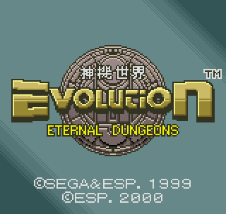
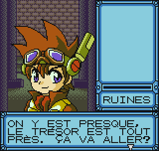

# Evolution: Eternal Dungeons — traduction française

**Evolution: Eternal Dungeons** (Neo Geo Pocket Color, ESP / Sting, 2000), entièrement en français :
toutes les scènes et dialogues, les combats, les objets, équipements, capacités et monstres, les menus,
la boutique, les écrans de statut et d'équipement, les noms de lieux et le générique de fin.

<p align="center">
  
  
</p>

- **Partie 1 (français)** : jouer en français — le patch et comment l'appliquer.
- **Part 2 (English)** : the translation kit — tools and guide to translate the game into another language.

---

# Partie 1 — Jouer en français

## 1.1 Ce qu'il vous faut

Le patch, au choix :

| Fichier | Contenu |
|---|---|
| `patch/Evolution_Eternal_Dungeons_FR_v1.0.ips` | la traduction française |
| `patch/Evolution_Eternal_Dungeons_FR_debug_v1.0.ips` | la même, avec en plus le **menu de débogage** caché du jeu (voir 1.5) |

**Votre propre** copie de la cartouche **européenne**, non modifiée et sans en-tête. Aucune ROM n'est
fournie ici. Vérifiez-la :

| | ROM d'origine attendue |
|---|---|
| Nom (par exemple) | `Evolution - Eternal Dungeons (Europe).ngc` |
| Taille | 2 097 152 octets |
| CRC32 | `BE47E531` |
| MD5 | `9c9c2d533be340600ef9f92ed1253dd9` |
| SHA-1 | `9f607095b038ccdbf98e6a8fce2dd67740ae5571` |

Avec une autre ROM (japonaise, déjà modifiée, autre dump), le patch donnera un jeu cassé.

## 1.2 Méthode A — patch appliqué à la volée par l'émulateur

L'émulateur applique le patch en mémoire à chaque lancement : la ROM d'origine n'est **pas modifiée**.
Posez le fichier `.ips` à côté de la ROM, **sous le même nom**, puis lancez la ROM normalement :

```
Evolution - Eternal Dungeons (Europe).ngc
Evolution - Eternal Dungeons (Europe).ips
```

Ce patch **agrandit** la ROM (2 Mio → 4 Mio). En cas de souci avec l'application à la volée, utilisez
la méthode B.

## 1.3 Méthode B — créer une ROM française (console, ou tout autre émulateur)

Fabriquez une fois pour toutes une ROM patchée :

- avec un outil IPS courant : **Rom Patcher JS** (dans le navigateur), **Flips** ou **Lunar IPS** ;
  choisissez la ROM européenne, puis le `.ips`, et enregistrez le résultat ;
- ou avec l'outil fourni (Python 3) :

  ```
  python tools/ips.py apply "Evolution - Eternal Dungeons (Europe).ngc" patch/Evolution_Eternal_Dungeons_FR_v1.0.ips Evolution_FR.ngc
  ```

La ROM obtenue doit avoir ces empreintes, quel que soit l'outil :

| | ROM française | ROM française + débogage |
|---|---|---|
| Taille | 4 194 304 octets | 4 194 304 octets |
| CRC32 | `70C3633A` | `8D296595` |
| SHA-1 | `6b562d763bfdca203008c82f11a763aa98f72252` | `7534501752bd453c2f339d2b83473e2a0715518c` |

## 1.4 Ce qui a été vérifié, ce qui ne l'a pas été (v1.0)

Vérifié à l'émulateur : écran titre, combat d'introduction, première scène, maison de Mag et ses menus,
place de la ville, boutique (dialogues, achat), menu de commandes, écrans d'objets, d'équipement et de
statut, un donjon, toute la séquence finale (via le menu de débogage) et le générique.

Tout le texte est contrôlé automatiquement (largeur et nombre de lignes de chaque boîte, place dans
chaque liste) : la ROM n'est pas fabriquée s'il reste une erreur. Pas encore vu à l'écran : la plupart
des scènes du milieu du jeu, l'atelier et la combinaison d'objets, la liaison câble. Un retour est
bienvenu si un texte déborde ou se coupe. La ROM n'a pas encore été essayée sur une vraie console.

## 1.5 Le menu de débogage (patch « debug »)

Le jeu contient un menu de test laissé par les développeurs, inaccessible normalement. Avec le patch
« debug », il apparaît en bas du **menu de commandes** (touche **OPTION** dans un menu de lieu, une fois
le tutoriel de la maison terminé) : **DEBUG**. Il permet de se rendre dans la ville ou dans n'importe quel
donjon (DONJ.), de valider des étapes (CLEAR), de rejouer les scènes de fin (SHIPEV), d'écouter les
musiques (JUKE), de voir le générique (STAFF) ou de modifier niveau, pièces et équipe (FLAG). Ce menu
est celui des développeurs : ses entrées sont laissées telles quelles. À réserver à la curiosité :
il peut casser une partie.

## 1.6 Choix de traduction

- Traduit d'abord depuis l'**anglais** officiel, puis **entièrement relu contre le japonais original** :
  l'anglais de la version européenne contient beaucoup de contresens, de phrases tronquées et
  d'explications de règles fausses, corrigés d'après le japonais.
- On **adapte** plutôt qu'on ne traduit mot à mot : chaque réplique doit avoir du sens dite par ce
  personnage. Les voix d'origine sont rendues (le majordome Gre très protocolaire, Chain brutale, le
  garde du corps et son « m'voyez », la fillette qui zozote…). Les jeunes se tutoient ; Gre vouvoie
  « Maître Mag ».
- **PV / PE / PT** pour HP / FP / TP (points de vie, d'énergie, de technique), **NV** pour le niveau.
- Noms propres gardés (Mag Launcher, Linear Cannon, Gre Nade, Chain Gun, Pepper Box, la SOCIETY, les
  ruines BLIND, SHEOL…) ; noms d'objets et d'attaques traduits.
- Quelques répliques japonaises restées non traduites dans la version européenne (fins d'étage) sont
  traduites directement depuis le japonais.
- La police du jeu n'a que des majuscules ; les accents É È Ê À Ç Ù Î Ô Û Â ont été ajoutés. Les noms de
  lieux des menus, dessinés dans une police étroite, ont été redessinés en français.

## 1.7 Crédits

- **Traduction française, police, outils** : **Tixul**, sous **licence MIT** (fichier `LICENSE`) pour les
  outils et les fichiers de traduction.
- *Evolution: Eternal Dungeons* © 1999 SEGA / ESP, © 2000 ESP. Ce projet de fans n'est ni affilié ni
  approuvé par les ayants droit. Il ne contient **ni ROM, ni BIOS, ni texte d'origine** : le patch ne
  contient que des octets modifiés, et le texte anglais n'est obtenu qu'en l'extrayant de sa propre ROM.

---

# Part 2 — Translation kit (English)

Everything needed to translate the game into **another Latin-alphabet language**. You edit text files;
the tools rebuild the ROM (text relocated into a second 2 MiB chip, longer and extra boxes, accented
font, tile-drawn place names, screen labels) and refuse to build while a rule is broken.

| Folder / file | Content |
|---|---|
| `lang/fr/` | the French translation (text files), its glossary and style guide — use it as your template |
| `tools/` | extract the text, check a translation, build the translated ROM and the IPS patch |
| `patch/` | the released French patches |
| `screenshots/` | the two screenshots shown at the top of this file |
| `FORMAT.md` | technical notes on the ROM: scripts, text codes, font, relocation, limits (in French) |

## 2.1 Requirements
- Python 3.9 or later (no other package needed).
- The original **European ROM** (hashes in section 1.1). The tools check it and refuse any other file.

## 2.2 Steps
1. **Extract the English text** from *your own* ROM (it is not distributed):
   ```
   python tools/extraire.py "Evolution - Eternal Dungeons (Europe).ngc" out/catalogue.tsv
   ```
   One line per text: `address · type · room (columns×lines) · English`. Types: `SCRIPT` (dialogue box),
   `ECRAN` (fixed-position text, ending credits), `MENU`, `COMBAT` (battle message), `POINTE` (items,
   skills, monsters, system messages), `AUTRE` (pieces of text assembled by the code).
2. **Copy** `lang/fr` to `lang/<code>` (e.g. `lang/es`) and translate (rules below).
3. **Check, then build** the ROM and the patch, and test in an emulator:
   ```
   python tools/controle.py ROM_EN.ngc lang/<code>/*.txt
   python tools/build.py --rom ROM_EN.ngc --lang <code> --ips
   python tools/build.py --rom ROM_EN.ngc --lang <code> --debug --ips     (with the debug menu)
   ```
   Output: `out/<code>.ngc` and `out/<code>.ips` (a patch for the **European** ROM).
   ⚠️ Distribute the **.ips** only, never the ROM.

## 2.3 File formats and rules

Every `*.txt` file in `lang/<code>/` is read; `#` starts a comment line. One line per text:

| Line | Meaning |
|---|---|
| `=ADDRESS<TAB>text` | the text found at this address in `out/catalogue.tsv` |
| `@ADDRESS<TAB>text` | the whole string at this address up to its end byte, rewritten in place (manual fixes) |

A text with no line keeps its English. In the text:
- `/` new line, `|` **new box** (dialogue and battle only: add as many boxes as you need).
- `{xx}` raw code, to keep: `{04}`..`{07}` number, `{08}`..`{0B}` inserted name (hero, monster, item),
  `{0C xx}` speed, `{0D xx}` colour, `{02 xx}` column, `{74}` / `{64}` target / number markers in some
  battle messages. Word order is free: put them where your language needs them.
- Lower case is accepted and turned into capitals (the game font has capitals only).

Limits, checked by `controle.py` and `build.py` (all errors are listed at once):
- Dialogue and battle boxes: **18 columns × 3 lines**. Other texts: the `room` column of the catalogue.
  `AUTRE` texts and `@` lines: no longer than the English (in bytes).
- Menus are padded with spaces automatically (the game does not clear them).
- Characters: `A-Z 0-9 . , ; : ! ? ' - + %`, `…` (or `...`), `[` `]` (shown as quotation marks) and the
  accented capitals `É È Ê À Ç Ù Î Ô Û Â`. They replace unused symbols of the font (`ACCENTS` in
  `tools/build.py`, drawn by `dessins()`): change them there for your language.

Language-specific graphics and fixed labels live in the tools (edit them for your language):
`tools/mots_tuiles.py` (`MOTS_FR`: place names drawn in the narrow tile font, ≤ 6 tiles),
`tools/libelles.py` (status / equipment / shop labels, rewritten in place), `tools/build.py`
(HP/FP icons of the battle screen, `dessins()`).

`build.py ROM_EN.ngc OUT.ngc --tout-en-saut` routes every dialogue and battle box through the
relocation jump with its original English text: the game must play exactly as the original.

## 2.4 Credits and legal
- French translation, font and tools: **Tixul**, released under the **MIT License** (see `LICENSE`).
- *Evolution: Eternal Dungeons* © 1999 SEGA / ESP, © 2000 ESP. This fan project is not affiliated with or
  endorsed by the rights holders. It contains **no ROM, no BIOS and no original game text**; the English
  text is only obtained by extracting it from your own ROM.
